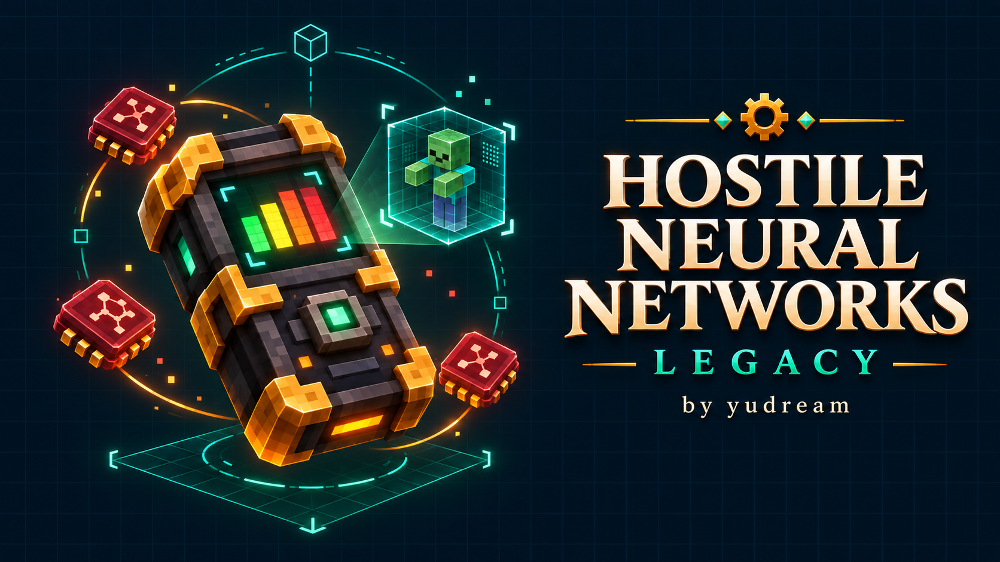
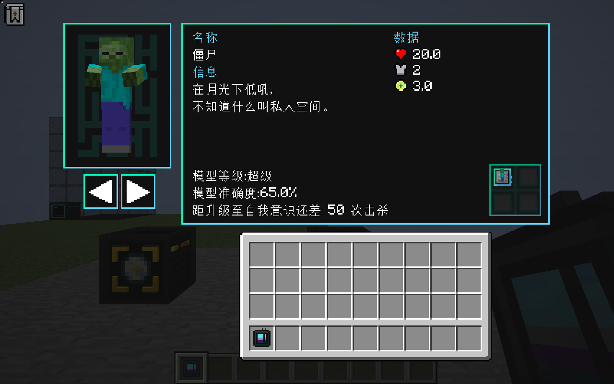
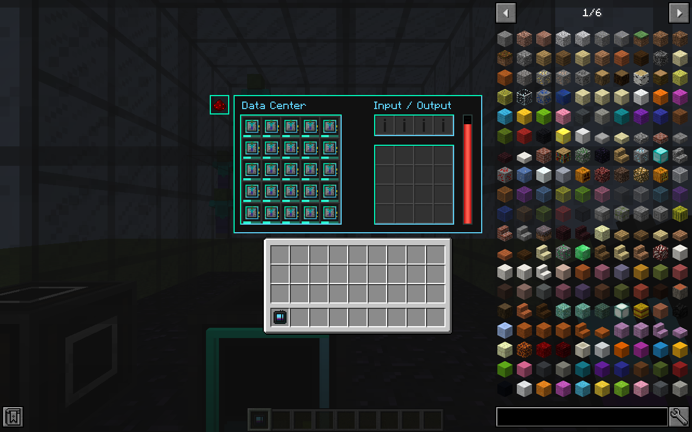

# Hostile Neural Networks Legacy

[](https://github.com/mcyudream/hostile-neural-networks-legacy/actions/workflows/ci.yml)
[下载发行版](https://github.com/mcyudream/hostile-neural-networks-legacy/releases/tag/v6.5.1-cleanroom.4) · [界面对照与截图](docs/UI.md) · [自定义模型](docs/CUSTOM-MODELS.md) · [验收记录](LEGACY-VERIFICATION.md)



<!-- legacy-overview:start -->
把 **Hostile Neural Networks 6.5.1** 的生物数据模型、模拟生产和战利品制造带到 **Minecraft 1.12.2**。通过击杀训练模型，再用 FE 和预测矩阵自动生产生物预测及战利品；数据中心可同时处理 25 个模型。

本次版本 **`6.5.1-cleanroom.4`** 修复终极模拟室在小窗口下的背包点击错位、扩展机器背包贴图及 JEI 遮挡，见 [界面修复与截图](docs/UI.md)。新增不依赖 AE2 的 [通用机器控制 API](docs/AUTOMATION-API.md)，供独立 AE2S / Supergiant 附属接入。

已并入 **Extra HNN 2.2.5**：四目标完美模型、融合室、模型模拟器、三种升级卡、设定卡、V1～V4 终极模拟室与终极制造器，以及可选血魔法**数字化苦难之井**。完整参数、操作流程、1.12 配方替代与授权见 [扩展玩法说明](docs/EXPANSION.md)。

保留龙之研究、热力基本、匠魂和血魔法的六个可选模型，见 [联动说明](docs/INTEGRATIONS.md)。正式 Cleanroom 0.4.0 的四组生产包验收记录见 [LEGACY-VERIFICATION.md](LEGACY-VERIFICATION.md)，安装包与源码包见 [GitHub Releases](https://github.com/mcyudream/hostile-neural-networks-legacy/releases/tag/v6.5.1-cleanroom.4)，CI 发布状态见 [PUBLICATION.md](PUBLICATION.md)。

## 下载与安装

1. 安装 **Minecraft 1.12.2、Cleanroom 0.4.0 正式版（无 `-alpha`）和 Java 25**。
2. 从 [GitHub Releases](https://github.com/mcyudream/hostile-neural-networks-legacy/releases/tag/v6.5.1-cleanroom.4) 下载 **`hostile-neural-networks-legacy-6.5.1-cleanroom.4.jar`**，放入客户端和服务器的 `mods/`。
3. 更新时替换本项目旧 jar。`-sources.jar` 是源码包，`-mcp.jar` 是开发产物，均不作为游戏安装文件。

| 项目 | 要求 / 标识 |
| --- | --- |
| Minecraft | 1.12.2 |
| 已验收加载器 | **Cleanroom 0.4.0 正式版（不带 `-alpha`）** |
| Java | **25** |
| Loader Mod ID | `hostile-neural-networks-legacy` |
| 资源与注册命名空间 | `hostilenetworks`（保留） |

运行必需项只有 Cleanroom，**不需要 Placebo**。当前目标为 Cleanroom / Java 25；未验证普通 Forge / Java 8。开发 SDK 的版本不改变上述兼容基线。

以下组件可选，均独立安装：

| 组件 | 已适配版本 | 用途 |
| --- | --- | --- |
| [Ponder Legacy](https://github.com/mcyudream/ponder-legacy/releases/tag/v1.4.0) | `1.4.0`，Mod ID `ponder-legacy` | 四套分步流程；安装血魔法后覆盖 24 个物品入口 |
| CraftTweaker | `4.1.20.698` | 安装上述 Ponder 时必需 |
| JEI | `4.16.1.302` | 模拟、制造产物、合成配方、数据中心与扩展机器说明 |
| 龙之研究 / 热力基本 / 匠魂 / 血魔法 | [已验证运行文件及前置](docs/INTEGRATIONS.md#验证用依赖版本) | 六个可选模型；龙研 / 热力使用 CodeChickenLib CRE 3.3.5 |

Ponder、CraftTweaker、JEI 均未嵌入 HNN jar。保留资源命名空间不构成跨实现的存档转换承诺。

<!-- legacy-authorship:start -->
## 作者与来源 / Authors and upstream

- Legacy 作者与维护者 / Legacy author and maintainer：**yudream**。
- 原作者 / Original author：**Brennan Ward / Shadows_of_Fire**。
- 原仓库 / Original repository：[Shadows-of-Fire/Hostile-Neural-Networks](https://github.com/Shadows-of-Fire/Hostile-Neural-Networks)。
- 并入的 Extra HNN 2.2.5：**LMor / nexxx_7**；[上游](https://github.com/lentel27/Extra-Hostile-Neural-Networks)、[MIT 许可证](licenses/Extra-HNN-MIT.txt) 与 [固定来源](expansion-upstream-lock.json)。
- 上游基线：`1.21` 分支、HNN **6.5.1**；固定提交 [`db9db507c490`](https://github.com/Shadows-of-Fire/Hostile-Neural-Networks/commit/db9db507c49008ea80fd422c998bfb9a602e64e1)。
- 本版本独立维护。上游版权、许可证和资源来源保留于 [LICENSE](LICENSE)、[NOTICE.md](NOTICE.md) 与 [导入清单](docs/import-report.json)。
<!-- legacy-authorship:end -->
<!-- legacy-overview:end -->

## 已移植内容

- 深度学习器、模型框架、数据模型、生物预测、预测矩阵、基础预测和制造指令卡。
- 模拟室：训练 / 推理、数据成长、连续准确率、超过 100% 准确率时的多次产出。
- 战利品制造机：按模型保存的固定产物或轮转队列。
- 数据中心：7×7×7 空心结构、25 个并行模型、共享原料和产物槽、四种 IO 端口。
- Forge Energy、物品管道 / 漏斗接口、红石控制、满仓缓冲、存档、服务端 GUI 校验与模型定义同步。
- 自定义 JSON 模型、等级与原子重载；中英文界面；学习器快捷键、模型实体预览与手持 HUD。
- Ponder 可选演示和 JEI 可选配方页；未安装时核心玩法正常运行。

默认启用 **29 个原版生物模型**，四项联动全部安装后为 **35 个生物模型**；另可开启 **8 个矿物方块模型**。当前共有 44 份定义，其中蝙蝠模型仍带 Reliquary 条件，未验证 1.12 Reliquary 注册名，不计入已验证兼容范围。初次导入与后续新增清单见 [import-report.json](docs/import-report.json)。

### 新增可选联动

| Mod | 新增模型 | 主要产物 |
| --- | --- | --- |
| 龙之研究 | 混沌守卫；已有末影龙模型增加龙之心选项 | 混沌碎片、龙之心、龙尘 |
| 热力基本 | Blizz、Blitz、Basalz | 三种对应元素棒 |
| 匠魂 | 蓝色史莱姆 | 蓝色、紫色和岩浆史莱姆球 |
| 血魔法 | 四种腐化生物共用一个腐化恶魔模型 | 含 50 意志的恶魔意志、五类意志结晶 |

模型支持框架绑定、学习器击杀成长、模拟、制造、数据中心和 JEI；混沌守卫与末影龙的多部位碰撞箱也可绑定。未安装对应 Mod 时自动跳过模型。混沌守卫模型一次击杀达到基础，推理需持续输入 **32,768 FE/t**。详细模型 ID、产物数量、前置与验收范围见 [联动说明](docs/INTEGRATIONS.md)。

## 核心玩法

1. 合成模型框架，右键受支持的生物进行绑定。新模型从故障级开始。
2. 将模型放进深度学习器的四个槽位之一，携带学习器击杀对应生物。僵尸模型从故障升到基础需要六次击杀；其他模型可能覆盖等级需求。
3. 把基础级或更高模型放入模拟室，输入预测矩阵和 FE。点击模式按钮切换训练 / 推理；正在运行的轮次结束后才能切换。
4. 推理得到生物预测后，将其送入战利品制造机。在界面左侧的 3×3 产物选板点击所需产物，供能后开始制造；右侧为输出库存。
5. 选择队列模式后，依次点击多个产物组成轮转队列；可以分页、移除或清空。制造指令卡可潜行右键复制制造机 / 数据中心设置，直接右键粘贴。

默认参数：

| 设备 / 模式 | 一轮处理时间 | 耗能 | 结果 |
| --- | --- | --- | --- |
| 模拟室：训练 | 300 tick | 模型基础 FE/t × 1.2，向上取整 | 数据 +1、迭代 +1，无产物 |
| 模拟室：推理 | 240 tick | 模型基础 FE/t | 固定基础预测，按准确率判定生物预测；不增加数据 |
| 战利品制造机 | 60 tick | 256 FE/t | 一个生物预测换取所选物品堆 |
| 数据中心 | 每个模型 300 tick | 各模型基础 FE/t × 1.5，向上取整 | 直接产出所选战利品及基础预测 |

20 tick 约为一秒。模拟室和数据中心还需要一 tick 建立轮次；表中列的是消耗能量的处理 tick。默认容量分别为模拟室 2,000,000 FE、制造机 1,000,000 FE、数据中心 8,000,000 FE。以僵尸为例，基础耗能为 128 FE/t。

| 默认等级 | 所需累计数据 | 每次世界行动增加的数据 | 基础准确率 |
| --- | --- | --- | --- |
| 故障 | 0 | 1 | 0% |
| 基础 | 6 | 4 | 5% |
| 进阶 | 54 | 10 | 22% |
| 卓越 | 354 | 18 | 65% |
| 自我意识 | 1254 | 0 | 100% |

默认在相邻等级间插值准确率。等级及各模型的需求 / 成长均可自定义。

学习器默认按 **U** 从快捷栏或副手打开。安装 Ponder 后，悬停学习器、框架、模拟室、制造机、数据中心或 IO 端口并按 **W** 可打开演示。

### 数据中心

1. 铺设 7×7 黑曜石地板，用黑色染色玻璃搭建墙壁和顶棚，外部总尺寸为 7×7×7。
2. 内部 5×5×5 完全留空。将紧贴地板上一层的一块墙面玻璃替换为数据中心，控制器正面朝外。
3. 界面确认结构完整后，放入最多 25 个自我意识级模型，提供原料和 FE。
4. **右键模型槽**打开该模型的独立制造设置页，选择产物或编辑队列，点击左侧返回箭头或按 ESC 返回。相同模型 ID 共享制造设置。
5. 可用 IO 端口替换墙壁或顶棚玻璃。右键端口循环切换「能量、模型、原料、产物」模式，再连接对应管线。模型端口允许有意提取模型。

控制器所在区块需要正常加载；运行时只临时加载结构跨越的相邻区块。结构被破坏或控制器拆除后，已有管线引用会拒绝访问。输出空间不足时停止新轮次；已付费轮次的产物进入可保存的缓冲区，腾出空间后释放，拆除机器也会掉落缓冲内容。

## 配置和整合包

普通配置位于 `config/hostilenetworks.cfg`，修改后重启游戏 / 服务器。包括能量容量、制造耗能、数据中心倍率、绑定开关、行动升级、连续准确率、训练限制、矿物模型开关及结构材质。

模型定义位于 `config/hostilenetworks/data_models/`，等级定义位于 `config/hostilenetworks/model_tiers/`。文件是完整定义，覆盖时不会与内置文件逐字段合并。

```text
data_models/zombie.json                         → hostilenetworks:zombie
data_models/mypack/custom_zombie.json            → mypack:custom_zombie
data_models/hostilenetworks/blocks/iron_ore.json  → hostilenetworks:blocks/iron_ore
model_tiers/basic.json                          → hostilenetworks:basic
```

管理员命令：

```text
/hostilenetworks reload
/hostilenetworks give_model <玩家> <模型ID> [等级ID或累计数据]
/hostilenetworks give_model Player zombie basic
/hostilenetworks give_model Player hostilenetworks:zombie 1254
```

`reload` 只重载模型和等级 JSON，成功后同步给在线客户端；无效的自定义定义会使本次重载失败并保留上一套定义。模型加载报告写入 `config/hostilenetworks/model-report.json`。JEI 当前在客户端初始化时建立配方页，修改模型后需重启客户端以刷新 JEI。

格式与示例见 [自定义模型说明](docs/CUSTOM-MODELS.md)。

## 界面

学习器、模拟室、制造机与数据中心使用上游原有 GUI 贴图、槽位位置、图标、翻页箭头和外置控制按钮。学习器保留实体预览、名称、trivia、属性图标与等级进度；数据中心右键模型进入独立制造设置页。小窗口会整体缩放，JEI 按实际显示范围避让侧边控件。布局对照与实机截图见 [界面对齐说明](docs/UI.md)。

以下为正式 Cleanroom 0.4.0 验收实例中的游戏截图：





## 与上游的差异

- 1.12 不存在的生物（例如溺尸、幻翼、猪灵、监守者、旋风人）不作替换。初次导入排除 39 份定义，其中 3 份热力定义现已按 1.12 注册名重新适配；其余未核实的第三方模型未声明兼容。
- 30 个基础合成配方已转换。制造机配方以钻石替代下界合金，数据中心以龙息替代回响碎片，框架中的平滑石改为石头。铁 / 金的粗矿产物改为对应矿石方块，需要后续冶炼。
- 保留暮色基础预测物品，但没有自动移植现代 Twilight Forest 的模型和额外配方；可通过自定义 JSON 为已核实的 1.12 目标添加模型。
- 不包含 Curios、Jade、现代 Placebo / NeoForge 注册与模型生成命令。绑定条件只支持本移植说明中的子集。
- 实体预览只适配部分上游 `display` 缩放与 NBT；尚未完整复现显示偏移、动画等参数。trivia 已在学习器中显示，按 1.12 字体换行。`rainbow` 颜色目前显示为青色。
- 上游 `pt_br.json` 存在语法错误，导入时跳过；其余可解析语言保留，中英文补充了本移植界面文本。
- 未提供旧世界或其他 HNN / Deep Mob Learning 实现的存档转换；不要假设它们的物品 NBT 可直接互换。
- 客户端收到服务器模型与配置后会保留同步内容；切换到使用另一套本地定义的世界前，需要重启客户端以重新加载本地配置。

## 正式基线验收

当前源码 `6.5.1-cleanroom.4` 使用实际生产 jar、原版 Minecraft 和官方运行库，在 **Cleanroom 0.4.0 正式版 / Java 25** 上完成以下验收：

| 运行组合 | 结果 | 运行检查数 |
| --- | --- | --- |
| 客户端，无联动 Mod / Ponder / JEI | PASS | 184 |
| 客户端，四项联动及 Ponder / CraftTweaker / JEI | PASS | 376 |
| 专用服务器，无联动 Mod / Ponder | PASS | 101 |
| 专用服务器，四项联动及 Ponder / CraftTweaker | PASS | 213 |

覆盖六个联动模型、Extra HNN 全部机器及完美模型、真实血魔法祭坛 / 献祭符文 / 催化剂、设定卡防复制、精确生产与耗能、25 模型并行、自动化与满仓缓冲、存档重载、GUI 操作、JEI 避让和 Ponder 播放。完整范围、安装包 SHA-256 和运行报告见 [安装包验收](LEGACY-VERIFICATION.md)；早期移植与 UI 验收见 [详细验证记录](docs/VERIFICATION.md)。

## 构建和 CI

使用 Java 25。在独立克隆的仓库中，先下载固定提交的可选编译依赖，再构建：

```bash
python3 tools/bootstrap_legacy.py
bash gradlew --no-daemon :build :reobfJar --console=plain
python3 tools/verify_legacy_package.py
```

当前源码的生产安装包位于 `build/libs/hostile-neural-networks-legacy-6.5.1-cleanroom.4.jar`。Ponder 适配使用同级 `../ponder`，或 bootstrap 下载的 `.legacy-deps/ponder`；发行 jar 不包含该运行库。

[GitHub Actions](https://github.com/mcyudream/hostile-neural-networks-legacy/actions/workflows/ci.yml) 在 `main` 推送、PR 和手动触发时编译源码、执行 Gradle 检查、重混淆并归档生产包、源码包及校验值。推送与安装包版本一致的 `v*` 标签后，CI 还会：

1. 核对版本、Mod 身份、作者、图标和开发代码隔离。
2. 强制比较生产 jar 与正式运行验收记录中的 SHA-256，并核对四套验收报告。
3. 全部通过后创建 GitHub Release，上传安装包、源码包和 `SHA256SUMS`。

本次发行标签为 `v6.5.1-cleanroom.4`，发行说明保存在 [docs/releases/6.5.1-cleanroom.4.md](docs/releases/6.5.1-cleanroom.4.md)。CI 构建不能替代客户端和专服运行验收；修改生产包后需重新验收并更新记录。CurseForge / Modrinth 的准备资料见 [发布说明](docs/PUBLISHING.md)，平台状态见 [PUBLICATION.md](PUBLICATION.md)。

### 本地运行验证

完整工作区可使用 `tools/dev.sh` 选择本地 Java 25；其他安装路径可设置 `HNN_JAVA_HOME`。首次构建需联网下载依赖和游戏资源。

```bash
./tools/dev.sh :build :reobfDevHarnessJar :ponder:reobfJar

# 官方 Cleanroom 0.4.0 正式版，使用发行 jar
python3 tools/verify_cleanroom_040.py client
python3 tools/verify_cleanroom_040.py client --with-ponder --with-jei --with-integrations
python3 tools/verify_cleanroom_040.py server
python3 tools/verify_cleanroom_040.py server --with-ponder --with-integrations

# 编译 SDK 0.7.14-alpha 下的开发检查
./tools/dev.sh :runClient -PhnnSmoke -PpackagedSmoke
./tools/dev.sh :runClient -PhnnSmoke -PpackagedSmoke -PwithPonder -PwithJei
./tools/dev.sh :runServer -PhnnServerSmoke -PpackagedSmoke
./tools/dev.sh :runServer -PhnnServerSmoke -PpackagedSmoke -PwithPonder
```

正式版验收脚本支持 Linux x64，复用校验过散列的运行库或按官方安装配方下载缺失文件；需要先完成一次开发环境资源与可选依赖下载。脚本在 `run/<当前构建版本>/cleanroom-0.4.0/` 下建立独立实例并写入 EULA 接受状态，使用前应已接受 Minecraft EULA。客户端实例需要图形环境。若同级 Ponder 正在开发其他版本，可通过 `LEGACY_PONDER_JAR` 指向已验收的独立运行库。

官方 Cleanroom 0.4.0 在专服发现 Mod 时会调用客户端 Kirino 入口。HNN 包含只在物理端 SERVER 且加载器精确为 `0.4.0` 时启用的兼容修复，隔离这一调用；在客户端和其他版本不注册该转换器。若其他 Mod 已修复同一调用，则不再修改。

测试会修改专用测试世界，请勿在 `run/` 下的验收实例保存个人内容。测试 Mod 位于 `src/dev/`，不包含在发行 jar 中。

## 授权与展示图

保留 Shadows-of-Fire 的代码、贴图、模型与翻译来源，见 [LICENSE](LICENSE)、[NOTICE.md](NOTICE.md) 和 [导入清单](docs/import-report.json)。

`branding/icon.png` 和 `branding/cover.png` 为本项目生成的展示图，用代表物品和概念表现项目；封面为展示插画。生成记录见 [branding/provenance.json](branding/provenance.json)。游戏实机截图见 [界面对齐说明](docs/UI.md)。
