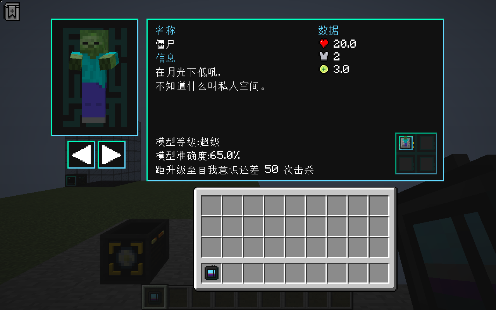
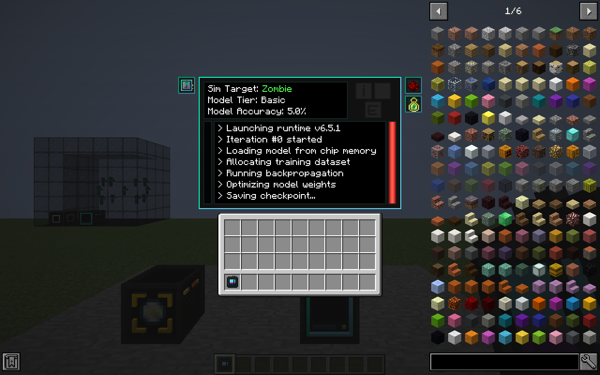
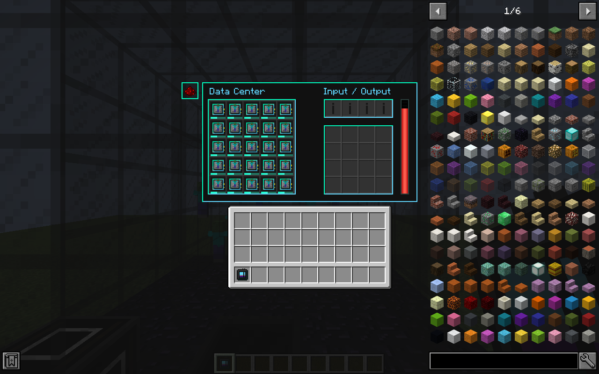
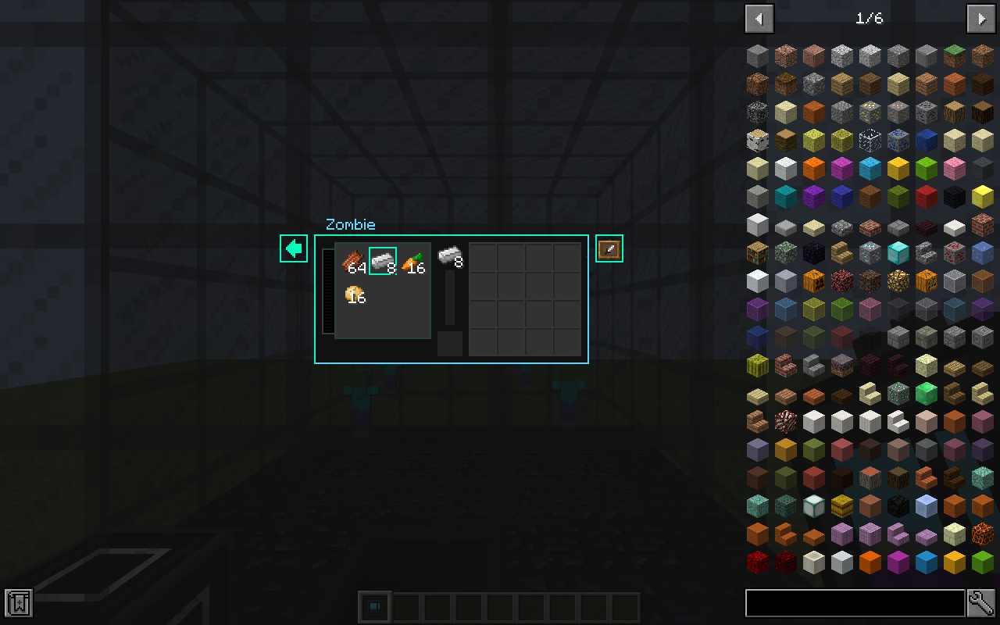
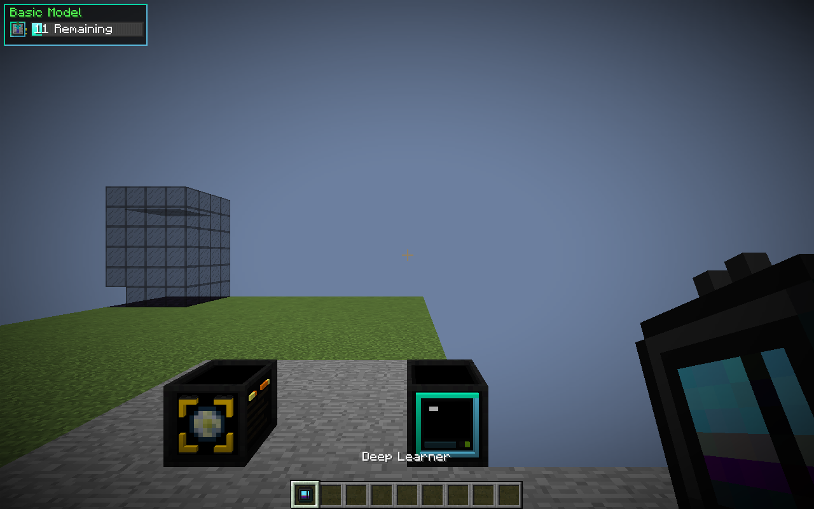

# 界面对齐

对照上游 `1.21` 分支固定提交 `db9db507c49008ea80fd422c998bfb9a602e64e1`。使用其原始 GUI PNG 与箭头贴图；布局坐标为 Minecraft GUI 逻辑像素。实机截图来自独立安装的 Cleanroom **0.4.0 正式版**，使用发行 jar。

## 布局

| 界面 | 尺寸 / 上游文件 | 本移植对应布局 |
| --- | --- | --- |
| 深度学习器 | 338×235；`DeepLearnerScreen` / `DeepLearnerMenu` | 主面板起点 `(41,0)`、实体面板 `(-41,0)`；模型四槽 `(256,99)`、`(274,99)`、`(256,117)`、`(274,117)`；背包起点 `(89,153)` |
| 模拟室 | 宽 232；`SimChamberScreen` / `SimChamberMenu` | 模型槽 `(-13,1)`；原料 `(176,7)`；输出 `(196,7)`、`(186,27)`；背包 `(36,153)`；右侧红石 / 模式按钮 `(228,0)`、`(228,20)` |
| 战利品制造机 | 176×178；`LootFabScreen` / `LootFabMenu` | 左侧 3×3 产物选板、中央当前产物 `(79,5)`、输入 `(79,62)`；右侧 4×4 输出；外置模式 / 队列；背包 `(8,96)` |
| 数据中心 | 230×223；`DataCenterScreen` / `DataCenterMenu` | 模型 `(9,21)` 起点，列间距 18、行间距 20；原料 `(132,20)`；输出 `(132,48)`；背包 `(35,140)` |
| 数据中心制造设置 | 176×100；`DataCenterFabConfigScreen` | 右键模型进入独立页面；隐藏并禁用库存槽；原版产物选板、翻页、模式 / 队列按钮；返回箭头或 ESC 返回 |
| 手持学习器 HUD | `DeepLearnerHudRenderer` | 上游九宫格背景、28 像素行距、模型卡片、等级文字和 89×12 进度条 |

模拟室上游名义高度为 230，但背包贴图绘制到第 235 像素；本移植以 235 计算可见高度，避免小窗口裁切。侧边控件与队列文字纳入整体居中和 JEI 占位计算。可见区域超出窗口时整体缩放，鼠标位置按同一比例转换。

红石、训练 / 推理、固定 / 队列按钮使用 Minecraft 1.12 自带的对应图标，包括熄灭火把与知识之书贴图。进入数据中心设置页时仍保留原服务端容器，按钮操作校验当前窗口和交互距离。

## 实机截图

### 学习器（中文、大 GUI 比例）

### 模拟室

### 制造机与外置队列（安装 JEI）

### 数据中心

### 数据中心制造设置

### 手持 HUD

## 保留的版本差异

1.12 字体与现代 Minecraft 字体存在差异，中文换行、字宽和实体姿势不保证逐像素相同。实体预览支持目标变体轮换、部分缩放与 NBT，尚未完整实现上游所有显示偏移和动画参数；彩虹等级色暂用青色。模型物品提示保留 1.12 文本样式，未移植现代自定义 tooltip 组件。

验证方式和完整报告见 [VERIFICATION.md](VERIFICATION.md)。
