# 界面对齐

## 6.5.1-cleanroom.4 终极模拟室背包修复

修复窗口较小时玩家背包、快捷栏与鼠标点击位置不一致的问题。`GuiScreen.handleMouseInput` 已按虚拟画布宽高换算鼠标坐标；此前在按下、释放、拖动及侧栏处理中再次除以缩放比例，导致界面缩小时取到其他格子的物品。现在只对绘制时的鼠标位置换算一次，输入沿用原版事件坐标。扩展机器的背包改用 Extra HNN 自带的 `extrahnn:textures/gui/inventory.png`，与机器面板保持一致。

绘制世界背景及触发 Forge 的 `BackgroundDrawnEvent` 时恢复实际视口的坐标与矩阵，保证 JEI 列表和按钮使用自己的正常比例，小窗口下也能避开 HNN 面板和侧栏。验收在缩放后的界面已经绘制数帧后检查 JEI 占位，并核对实际截图。

回归使用正式 Cleanroom 0.4.0 的生产安装包，将 36 个背包槽填入不同编号和数量的物品，在 1280×800 普通窗口与 960×480 小窗口下检查三行背包和快捷栏两端的真实取出、放回及服务器同步。小窗口测试断言缩放确实小于 0.95；旧安装包在该条件下无法从第一行正确取出物品，失败记录保存在 [修复前记录](verification/6.5.1-cleanroom.4/inventory-before-fix/report.json)。

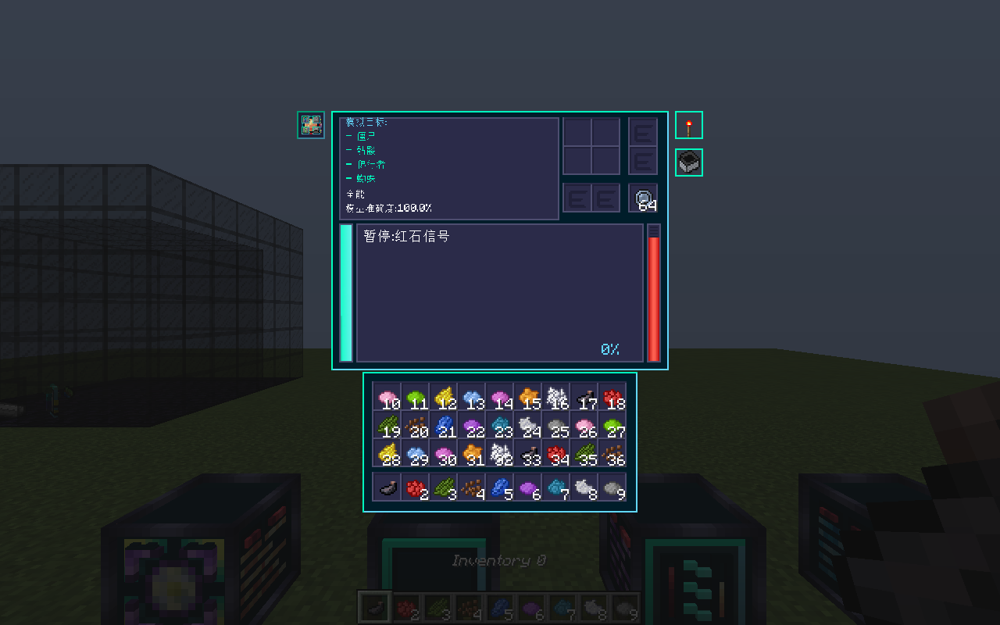

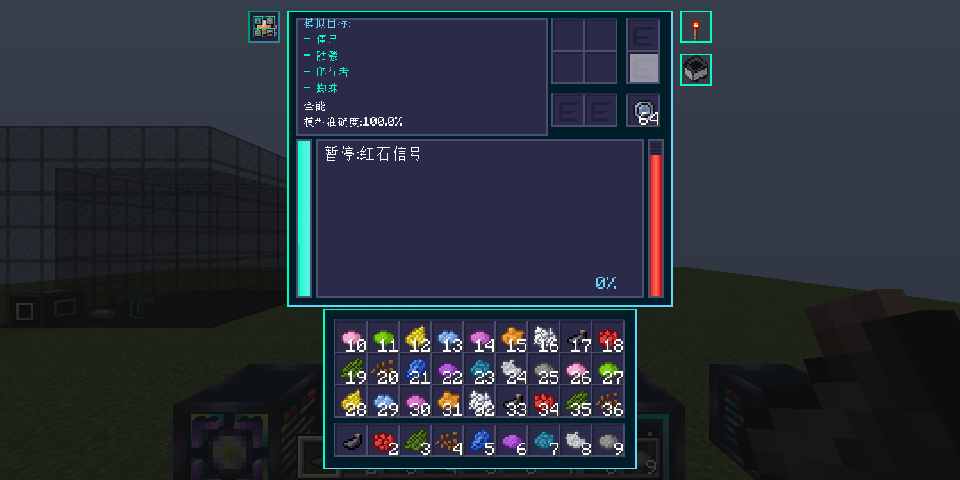

## 6.5.1-cleanroom.3 新增界面

Extra HNN 界面固定对照 `950bc0327ed3ace3911eebf2eab5d0aca3b44949`，使用其原始 MIT PNG、模型和物品资源。
槽位沿用原版逻辑坐标；终极模拟室按背包实际绘制边界以 257 像素计算可见高度。

| 界面 | 逻辑尺寸 | 槽位 / 背包坐标 |
| --- | --- | --- |
| 模型融合室 | 216×243 | 四模型 `(63,10)`、`(88,8)`、`(112,8)`、`(137,10)`；框架 `(183,35)`、输出 `(100,35)`；背包 `(28,161)` |
| 模型模拟器 | 232×188 | 模型 `(-13,1)`、升级 `(-13,21)`、`(-13,39)`；背包 `(36,106)` |
| 终极模拟室 | 232×257 | 模型 `(-13,1)`、原料 `(200,48)`；八个输出按原版布局；背包 `(36,175)` |
| 终极制造器 | 212×210 | 输入 `(79,74)`；6×6 输出从 `(100,7)` 开始；背包 `(26,128)` |
| 数字化苦难之井 | 232×188 | 模型 `(-13,1)`、催化剂 `(-13,25)`；祭坛坐标、LP、催化次数与进度 |

保留原有缩放和 JEI 控件避让。完美模型渲染后恢复光照贴图，避免蜘蛛眼睛等实体层导致后续物品、文字变黑。

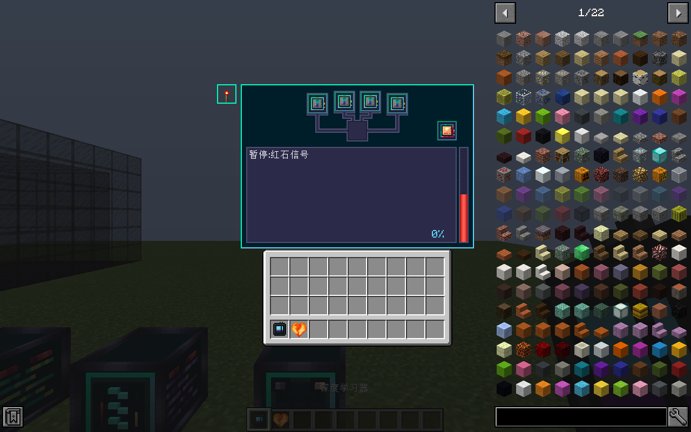

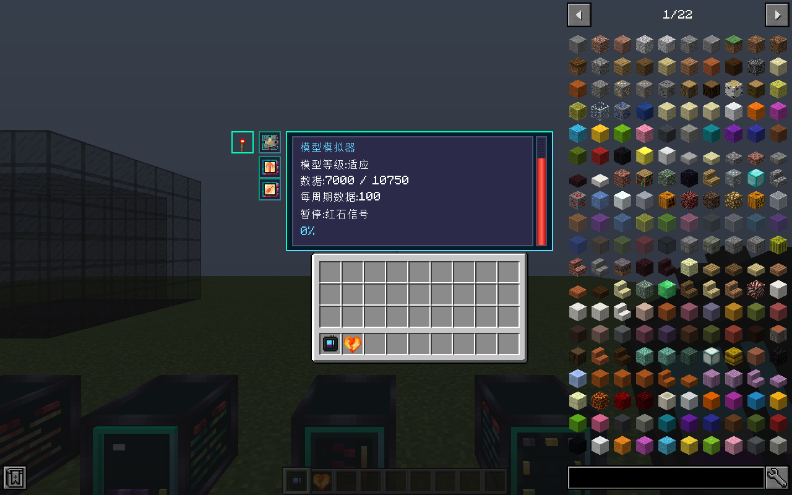

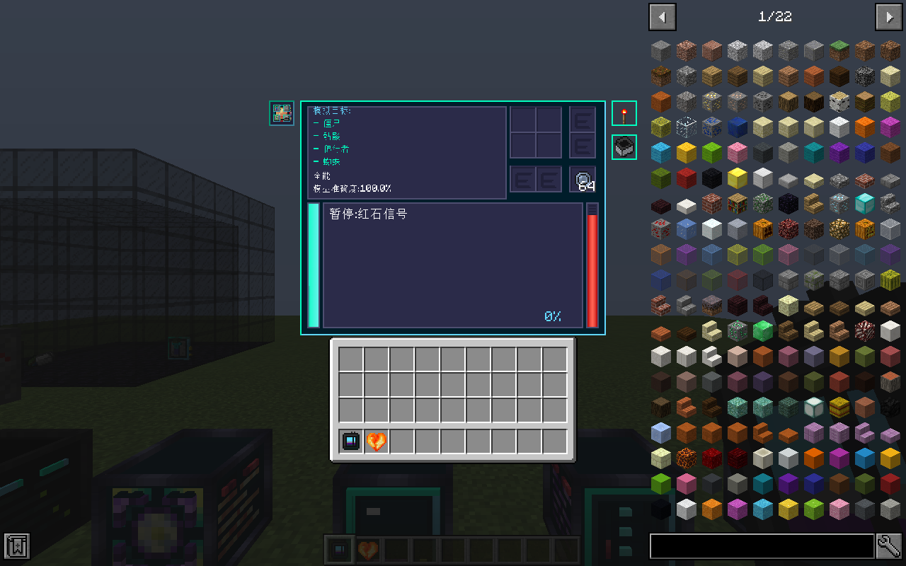

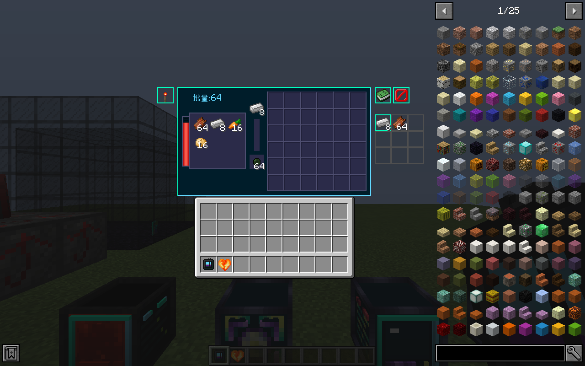

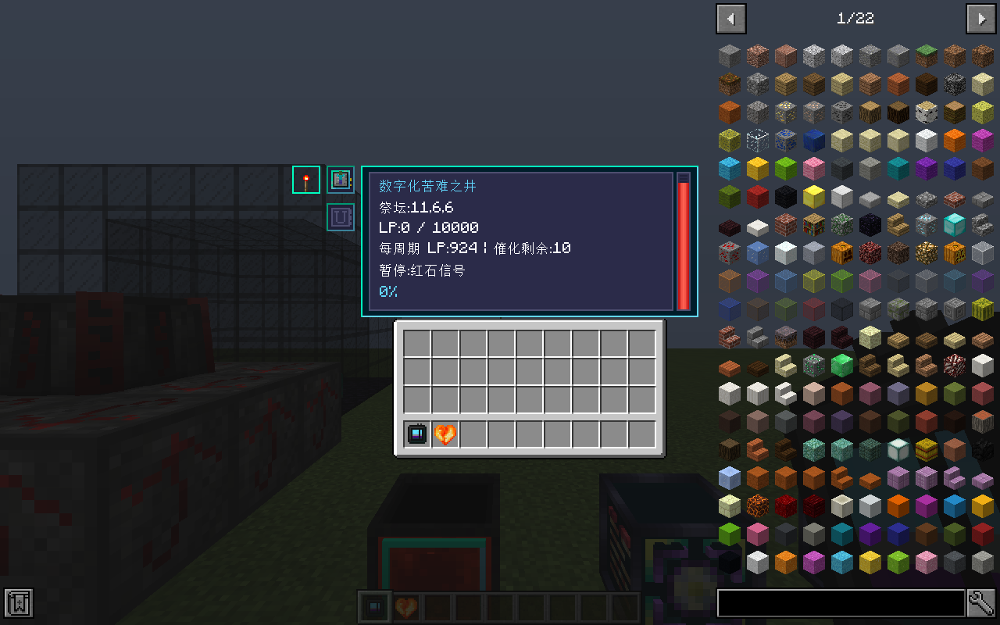

## 原 HNN 界面

对照上游 `1.21` 分支固定提交 `db9db507c49008ea80fd422c998bfb9a602e64e1`。使用其原始 GUI PNG 与箭头贴图；布局坐标为 Minecraft GUI 逻辑像素。实机截图来自独立安装的 Cleanroom **0.4.0 正式版**，使用发行 jar。

## 布局

| 界面 | 尺寸 / 上游文件 | 本移植对应布局 |
| --- | --- | --- |
| 深度学习器 | 338×235；`DeepLearnerScreen` / `DeepLearnerMenu` | 主面板起点 `(41,0)`、实体面板 `(-41,0)`；模型四槽 `(256,99)`、`(274,99)`、`(256,117)`、`(274,117)`；背包起点 `(89,153)` |
| 模拟室 | 宽 232；`SimChamberScreen` / `SimChamberMenu` | 模型槽 `(-13,1)`；原料 `(176,7)`；输出 `(196,7)`、`(186,27)`；背包 `(36,153)`；右侧红石 / 模式按钮 `(228,0)`、`(228,20)` |
| 战利品制造机 | 176×178；`LootFabScreen` / `LootFabMenu` | 左侧 3×3 产物选板、中央当前产物 `(79,5)`、输入 `(79,62)`；右侧 4×4 输出；外置模式 / 队列；背包 `(8,96)` |
| 数据中心 | 230×223；`DataCenterScreen` / `DataCenterMenu` | 模型 `(9,21)` 起点，列间距 18、行间距 20；原料 `(132,20)`；输出 `(132,48)`；背包 `(35,140)` |
| 数据中心制造设置 | 176×100；`DataCenterFabConfigScreen` | 右键模型进入独立页面；隐藏并禁用库存槽；原版产物选板、翻页、模式 / 队列按钮；返回箭头或 ESC 返回 |
| 手持学习器 HUD | `DeepLearnerHudRenderer` | 上游九宫格背景、28 像素行距、模型卡片、等级文字和 89×12 进度条 |

模拟室上游名义高度为 230，但背包贴图绘制到第 235 像素；本移植以 235 计算可见高度，避免小窗口裁切。侧边控件与队列文字纳入整体居中和 JEI 占位计算。可见区域超出窗口时整体缩放，鼠标位置按同一比例转换。

红石、训练 / 推理、固定 / 队列按钮使用 Minecraft 1.12 自带的对应图标，包括熄灭火把与知识之书贴图。进入数据中心设置页时仍保留原服务端容器，按钮操作校验当前窗口和交互距离。

## 实机截图

### 学习器（中文、大 GUI 比例）

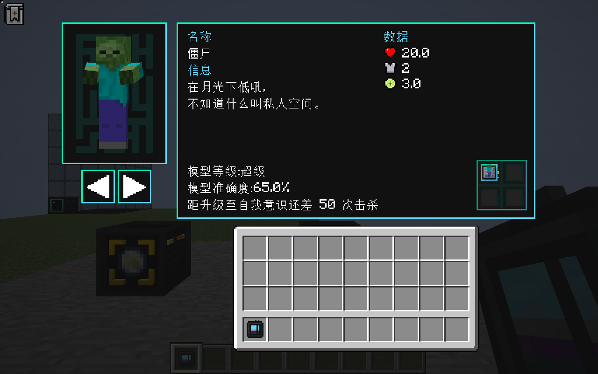

### 模拟室

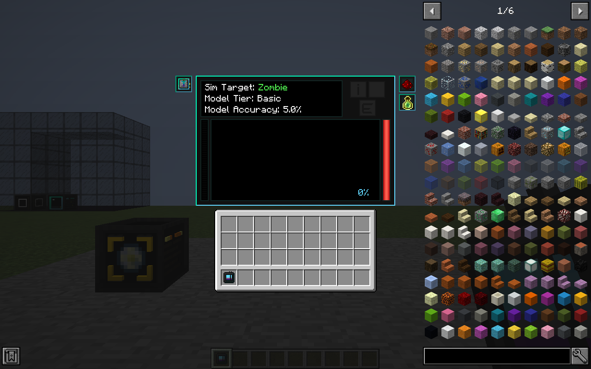

### 制造机与外置队列（安装 JEI）

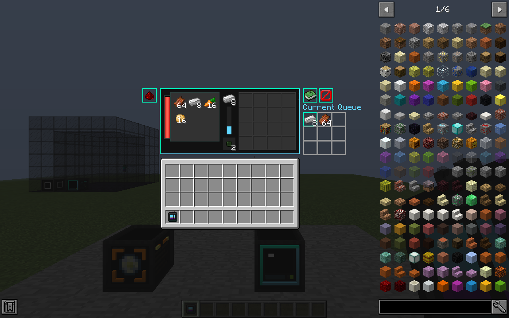

### 数据中心

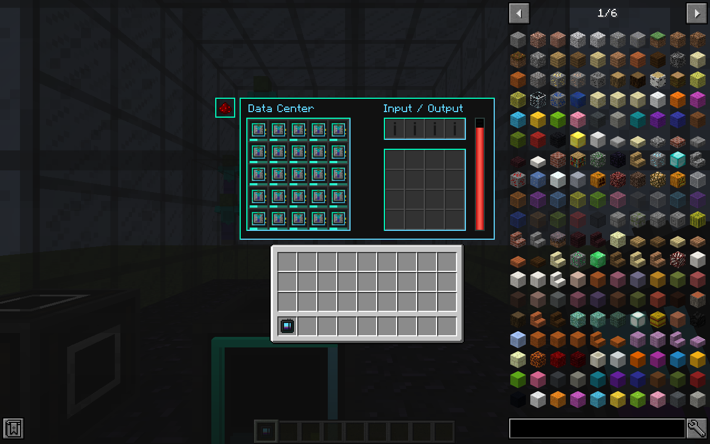

### 数据中心制造设置

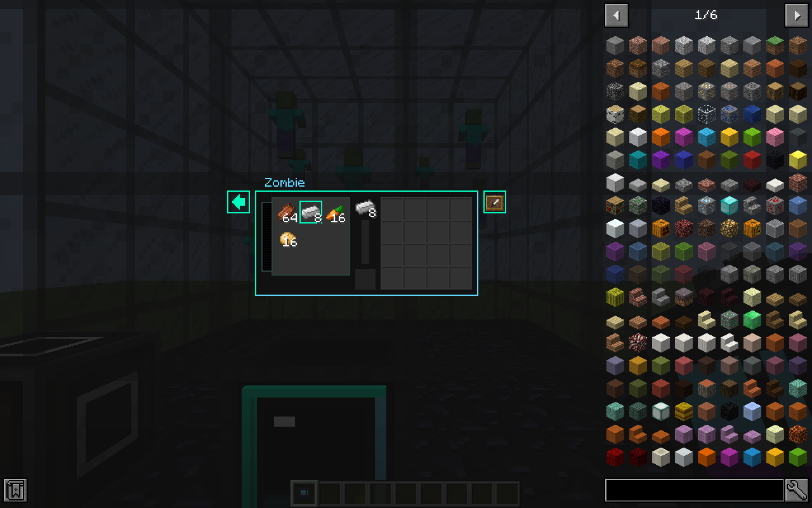

### 手持 HUD

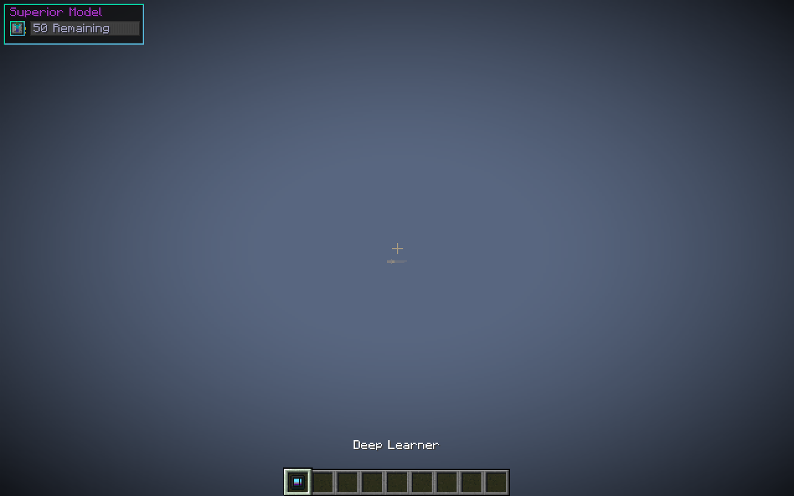

## 保留的版本差异

1.12 字体与现代 Minecraft 字体存在差异，中文换行、字宽和实体姿势不保证逐像素相同。实体预览支持目标变体轮换、部分缩放与 NBT，尚未完整实现上游所有显示偏移和动画参数；彩虹等级色暂用青色。模型物品提示保留 1.12 文本样式，未移植现代自定义 tooltip 组件。

验证方式和完整报告见 [VERIFICATION.md](VERIFICATION.md)。

## 6.5.1-cleanroom.2 联动模型预览

新增六个模型继续使用同一套学习器布局。混沌守卫单独缩小至 `display.scale = 0.125`，使翅膀保持在预览面板内。

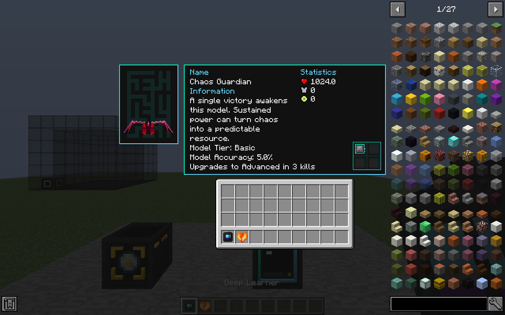

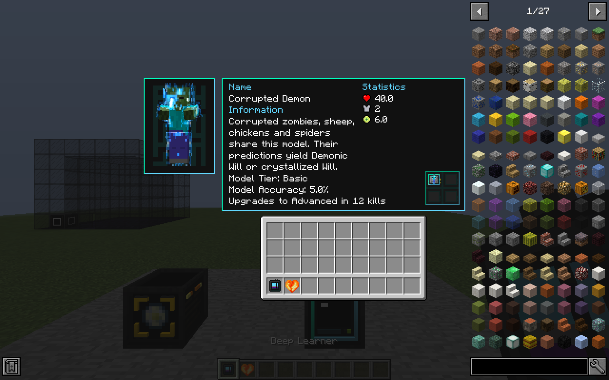
